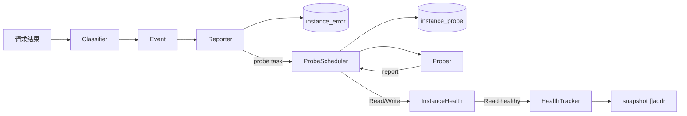
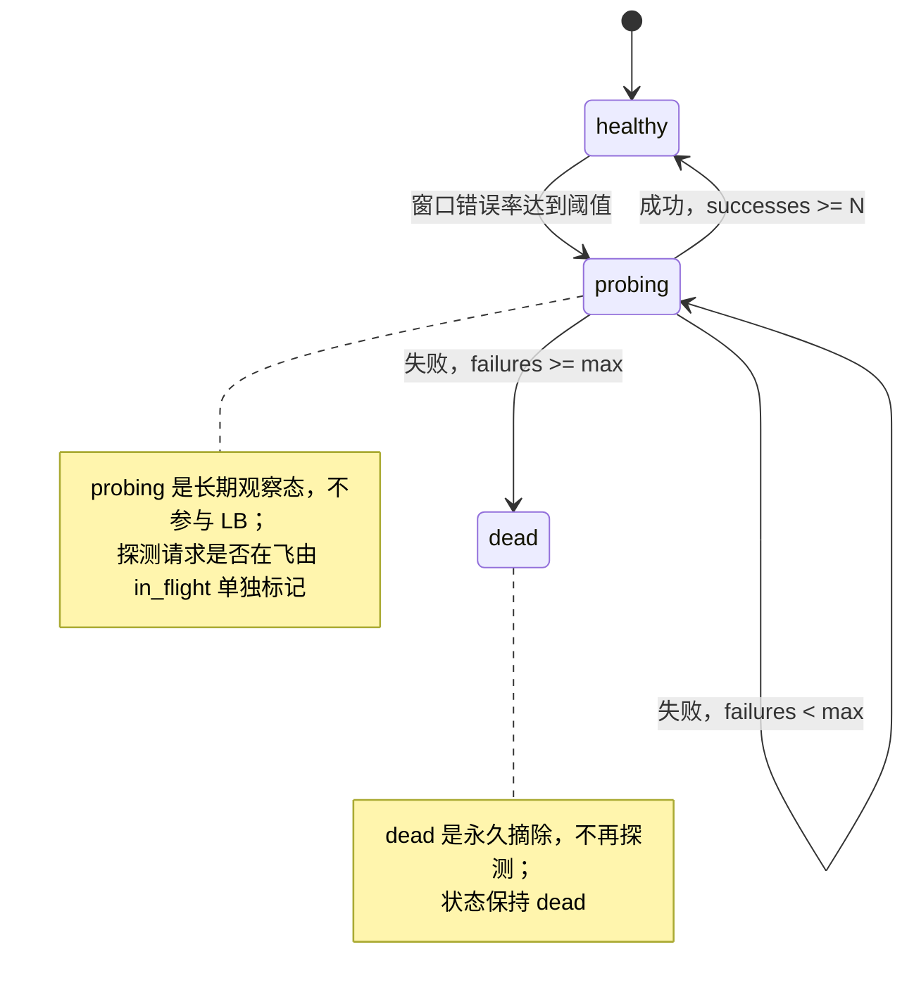
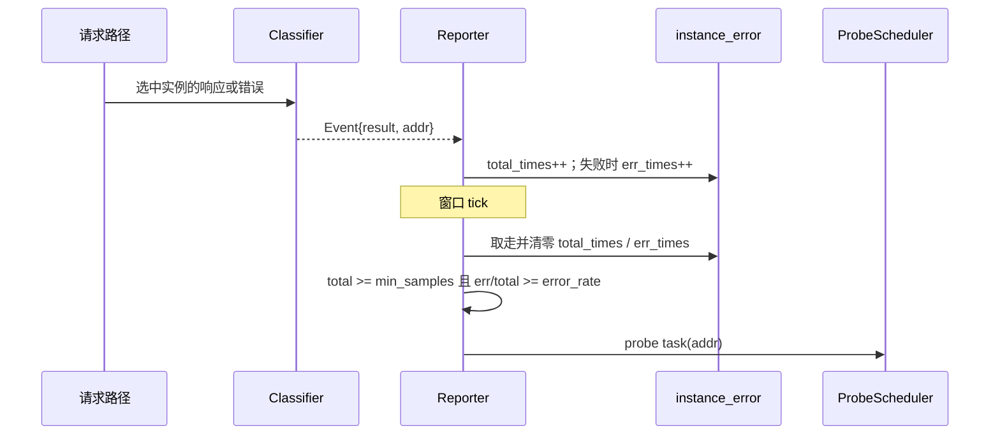
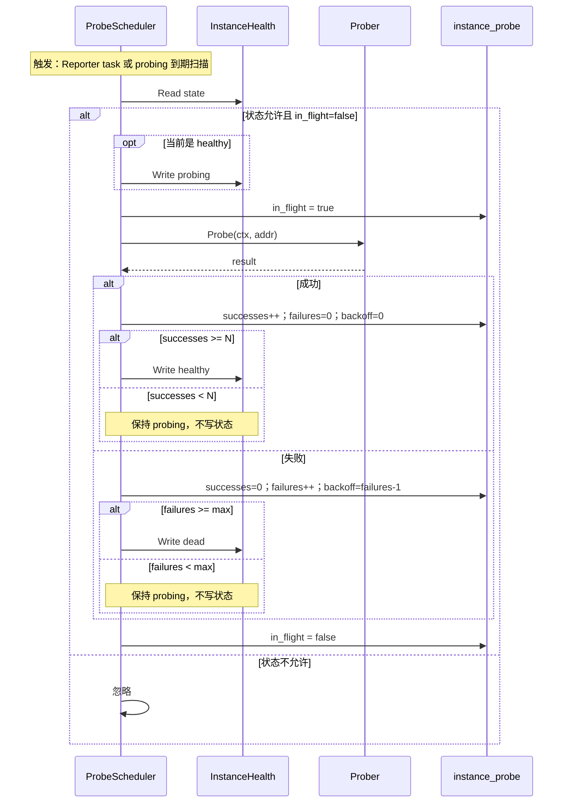
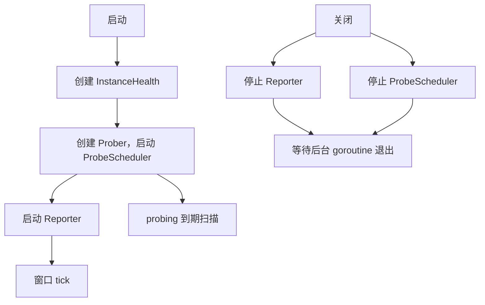
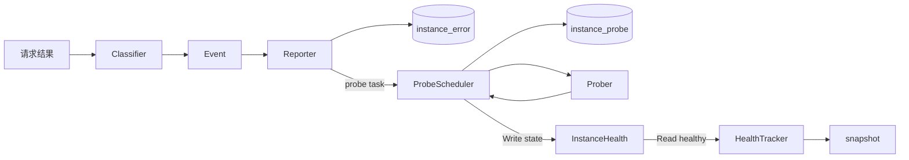

# 1. 组件全景

## 1.1 组件清单

| 组件 | 核心职责 |
|---|---|
| `HealthTracker` | 生命周期编排、读取 healthy 生成候选快照 |
| `InstanceHealth` | 唯一状态源，保存 `instance_status` 和状态索引 |
| `Classifier` | 把请求结果归一化为成功 / 失败 |
| `Reporter` | 维护 `instance_error`，固定窗口计算错误率，推送 probe task |
| `ProbeScheduler` | 主动探测、连续成功确认、退避、probing 恢复、写状态 |
| `Prober` | 协议探活，首版 TCP |

## 1.2 组件关系



- **唯一状态源**：状态只存在 `InstanceHealth`。
- **唯一状态写者**：`ProbeScheduler` 写 `probing` / `healthy` / `dead`。
- **唯一探测入口**：`ProbeScheduler` 统一处理 Reporter task 和 probing 恢复，不区分来源。
- **探测结果路径**：`Prober` 的结果回到 `ProbeScheduler`。
- **dead 终态**：`dead` 表示永久摘除，不再探测，也不参与 LB。

## 1.3 状态机



- **初始状态**：所有实例为 `healthy`。
- **N**：连续成功阈值，即 `probe.success_threshold`。
- **probing**：长期观察态，实例在确认或恢复期间一直不参与 LB，但仍会继续探测。
- **dead**：永久摘除，不参与 LB，也不再探测。
- **in_flight**：只表示探测请求正在执行，不是状态，不参与快照。
- **进入 dead**：`probing` 连续失败达到上限时进入 `dead`，之后不再探测。

# 2. 组件设计

## 2.1 HealthTracker

- **核心职责**：创建并启动 Reporter 与 ProbeScheduler，读取 `InstanceHealth` 输出候选快照。

- **职责边界**
  - 不接收 probe 结果。
  - 不写 `InstanceHealth` 状态。
  - 不做错误率统计。
  - 不管理探测周期和退避。

- **关键行为**
  - **快照**：只读 `healthy`，输出 `[]addr`。
  - **启动**：创建状态表，先启动 ProbeScheduler，再启动 Reporter。
  - **关闭**：先停 Reporter，再停 ProbeScheduler，等待探测 goroutine 退出。
  - **空候选**：快照为空时由调用方映射为 503。

- **对外接口**

  ```go
  type HealthTracker struct {
      health    *InstanceHealth
      reporter  *Reporter
      scheduler *ProbeScheduler
      closed    atomic.Bool
  }

  // New 校验失败返回配置错误。
  func New(cfg Config, addrs []string) (*HealthTracker, error)

  // Start 启动 ProbeScheduler 与 Reporter。
  func (h *HealthTracker) Start()

  // Snapshot 只读，仅返回 healthy 地址。
  func (h *HealthTracker) Snapshot() []string

  // Close 幂等，等待后台 goroutine 退出。
  func (h *HealthTracker) Close() error
  ```

## 2.2 InstanceHealth

- **核心职责**：保存所有实例的当前状态，提供按地址和按状态的读取，以及唯一的状态写入入口。

- **职责边界**
  - 不做健康判定。
  - 不发起探测。
  - 不统计错误率。
  - 不保存 probe 计数、退避或 `in_flight`。

- **内部状态**

  ```go
  type InstanceHealth struct {
      mu    sync.RWMutex
      table map[string]*instanceStatus
      stat  map[State][]*instanceStatus
  }
  ```

  `instanceStatus` 与 `State` 的定义见 4.1.1。

- **读写语义**
  - **Read**：返回 `instance_status` 的副本；多个读并发。
  - **ReadByState**：返回指定状态的地址切片；多个读并发。
  - **Write**：独占写，写期间阻塞所有读；同一把锁内更新 `table`、`stat` 和 `updated_at`。
  - **单写者**：运行时只有 `ProbeScheduler` 调用 `Write`；初始状态由 `HealthTracker` 建表时写入。

- **状态索引**
  - 状态变化时必须从旧状态的 `stat` 桶移除，再加入新状态的桶。
  - `table` 和 `stat` 都保存 `*instance_status`，共享同一对象。
  - 不允许只更新一张表；两张表在同一次 `Write` 内完成。

- **生命周期**：由 `HealthTracker` 创建，进程内常驻，进程退出后全部丢失。

## 2.3 Classifier

- **核心职责**：把选中实例的响应或错误转换成 `Event{result, addr}`。

- **职责边界**
  - 不读状态。
  - 不计数。
  - 不判断实例是否健康。

- **输入输出**

  ```go
  type Classifier struct{}

  // Classify 把选中实例的响应或错误转换成 Event。
  func (c *Classifier) Classify(addr string, resp *message.Response, err error) Event
  ```

- **判定规则**

  | 结果 | `result` | 说明 |
  |---|---|---|
  | 2xx / 3xx / 4xx | `true` | 实例有有效响应，视为成功 |
  | 5xx | `false` | 后端明确失败 |
  | 拨号、写请求、读响应失败 | `false` | 连接层失败 |
  | 协议转换、响应还原失败 | `false` | 协议层失败 |
  | 池耗尽、池关闭、无候选 | 不产生 Event | 不归因到实例 |

- **成功语义**：4xx 视为成功，因为实例可达；如果业务要求 4xx 计失败，只改映射表。

## 2.4 Reporter

- **核心职责**：按实例累计窗口内的总请求数和失败数，周期性计算错误率并推送 probe task。

- **职责边界**
  - 不写 `InstanceHealth`。
  - 不发起探测。
  - 不判断实例状态。
  - 不做恢复确认。

- **内部状态**

  ```go
  type Reporter struct {
      table map[string]*instanceError
      cfg   ReporterConfig
      probe *ProbeScheduler
  }

  type instanceError struct {
      totalTimes atomic.Int64 // total_times
      errTimes   atomic.Int64 // err_times
  }
  ```

- **窗口行为**
  1. 每个 `Event` 都累加 `total_times`；`result=false` 时再累加 `err_times`。
  2. 每个 `reporter.window` 执行一次 tick。
  3. tick 对每个实例先取走并清零 `total_times`、`err_times`。
  4. `total_times >= min_samples` 且 `err_times / total_times >= error_rate` 时，把地址推给 `ProbeScheduler`。
  5. 不满足条件只跳过推送；计数已经清零，下一轮重新累计。

- **低流量处理**
  - `min_samples` 防止单次失败就是 100% 错误率。
  - 如果窗口内总请求数一直达不到 `min_samples`，该实例不会被触发探测。
  - 低流量关键实例可以调低 `min_samples`，或后续改用跨窗口累计。

- **并发**
  - `table` 启动时按实例建好，运行期只读；计数用原子操作。
  - 请求路径只做原子累加。
  - tick 先取走计数再判断，避免清零瞬间丢计数。
  - 两个计数分别取走会有极小边界误差，健康判定可接受。

- **生命周期**：由 HealthTracker 启动；Close 停止 ticker，不再接收 Event。

## 2.5 ProbeScheduler

- **核心职责**：接收 Reporter 的 probe task，扫描 probing 的到期实例，执行探测、连续成功确认和退避，并写回状态。

- **职责边界**
  - 不做被动错误率统计。
  - 不生成候选快照。
  - 不管理 `instance_error`。
  - 不区分“初次确认”和“probing 恢复”；两者使用同一套参数和处理流程。
  - 不扫描 `dead`，`dead` 是永久摘除。

- **内部状态**

  ```go
  type ProbeScheduler struct {
      table   map[string]*instanceProbe
      health  *InstanceHealth
      prober  Prober
      cfg     ProbeConfig
      sem     chan struct{}
      results chan probeResult
  }

  type instanceProbe struct {
      successes   int       // probe_successes
      failures    int       // probe_failures
      backoff     int       // 连续失败次数减一
      nextProbeAt time.Time // next_probe_at
      inFlight    bool      // in_flight
  }

  type probeResult struct {
      addr string
      err  error
  }
  ```

- **触发方式**
  - **Reporter task**：只接受 `healthy`，进入观察态并立即探测。
  - **到期扫描**：调度器每 1s 扫描 `probing`，对 `next_probe_at <= now` 且 `!in_flight` 的实例发起探测。
  - **调度串行**：Reporter task、到期扫描和探测结果都由同一个调度 goroutine 处理；状态检查、置 `probing`、`in_flight` 和计数更新不并发。
  - **表结构只读**：`table` 启动时按实例建好，运行期只更新字段值。

- **开始探测**
  1. 读取当前状态。
  2. Reporter task 只在 `healthy` 时接受；`probing` / `dead` 的 task 忽略。
  3. 到期扫描只处理 `probing`；`dead` 不再探测。
  4. 检查 `in_flight=false`。
  5. 获取并发信号量；失败则跳过本轮，不改变状态。
  6. 置 `in_flight=true`；若当前不是 `probing`，写 `probing`，已是 `probing` 则不重复写。
  7. 调用 `Prober.Probe`。

- **探测成功**
  - `probe_successes++`。
  - `probe_failures=0`。
  - `backoff=0`。
  - `probe_successes >= success_threshold`：写 `healthy`，清零计数与下次时间。
  - `probe_successes < success_threshold`：保持 `probing`（不写状态），`next_probe_at=now+base_interval`。
  - `in_flight=false`。

- **探测失败**
  - `probe_successes=0`。
  - `probe_failures++`。
  - `backoff=probe_failures-1`。
  - `in_flight=false`。
  - `probe_failures < max_failures`：保持 `probing`（不写状态），`next_probe_at=now+backoff_interval`。
  - `probe_failures >= max_failures`：写 `dead`，清零 `next_probe_at`，不再探测。

- **参数统一**
  - 初次确认和 probing 恢复共用 `success_threshold`、`max_failures`、`base_interval`、`max_interval`、`jitter`。
  - 不维护 `recovering` 标志，也不按来源分支。
  - `probing` 是长期观察态；`in_flight` 只防重复探测；`dead` 不再探测。

- **信号量释放**：成功、失败、超时三种结果处理完成后都释放 `sem`。

- **生命周期**：由 HealthTracker 启动；Close 取消 ticker，等待在途探测退出，停止写状态。

## 2.6 Prober

- **核心职责**：执行一次协议探活，把结果返回给 `ProbeScheduler`。

- **职责边界**
  - 不读状态。
  - 不写状态。
  - 不计数。
  - 不重试。

- **接口**

  ```go
  type Prober interface {
      Type() string
      Probe(ctx context.Context, addr string) error
  }
  ```

  `Probe` 返回 `nil` 表示成功，超时按失败处理。

- **TCP 实现**
  - 带超时的 `DialContext`。
  - 拨号成功后立即关闭连接。
  - 不读取、不发送业务数据。
  - 结果只表示端口可连接，不表示业务可用。

- **生命周期**：由 ProbeScheduler 创建；每次探测建立一次性连接，不持有长连接。

# 3. 组件交互

## 3.1 交互清单

| 调用方 | 被调方 | 交互数据 | 语义 |
|---|---|---|---|
| `Classifier` | `Reporter` | `Event{result, addr}` | 同步，无锁 |
| `Reporter` | `ProbeScheduler` | probe task（地址） | 异步推送 |
| `ProbeScheduler` | `InstanceHealth` | Read / Write 状态 | 读返回副本，写独占 |
| `ProbeScheduler` | `Prober` | 上下文、地址 | 异步，带超时，不重试 |
| `Prober` | `ProbeScheduler` | 探测结果 | 通过 channel 回传 |
| `HealthTracker` | `InstanceHealth` | ReadByState(healthy) | 只读快照 |

## 3.2 被动上报



- **入口**：请求拿到选中实例的结果。
- **出口**：计数已累加；达到阈值时推送 probe task。
- **异常**：池耗尽、池关闭、无候选不产生 Event。

## 3.3 主动探测



- **Reporter task**：只接受 `healthy`。
- **到期扫描**：只处理 `probing`；`dead` 不再探测。
- **失败未达上限**：状态保持 `probing`，只更新失败计数、退避和下次探测时间。
- **失败达到上限**：写 `dead`，清空下次探测时间，之后不再探测。
- **重复探测**：由 `in_flight` 阻止；`probing` 本身是长期状态，不能单靠它防重复。
- **结果回传**：探测 goroutine 只执行 `Probe`，结果通过 channel 回到调度 goroutine；计数和 `in_flight` 只在那里更新。
- **超时**：按探测失败处理。

## 3.4 启动与关闭



- **启动顺序**：先建状态并启动 ProbeScheduler，再启动 Reporter；消费者先于生产者。
- **关闭顺序**：先停 Reporter，再停 ProbeScheduler。
- **重复关闭**：幂等返回。

## 3.5 数据流转



- **被动数据**：Event → `instance_error`。
- **主动数据**：probe result → `instance_probe` 和 `instance_status`。
- **快照**：只读 `instance_status` 的 healthy 部分。

# 4. 数据与配置

## 4.1 数据模型

正文沿用文档字段名（如 `total_times`、`probe_successes`）；Go 结构体字段使用 camelCase，对应关系见 2.4、2.5 和 4.1.1 的代码注释。

### 4.1.1 instance_status

```go
type State uint8

const (
    StateHealthy State = iota // healthy
    StateProbing              // probing: 观察中，仍会探测
    StateDead                 // dead: 永久摘除，不再探测
)

type instanceStatus struct {
    addr      string
    state     State
    updatedAt time.Time // updated_at
}
```

- **索引**：`stat[state]` 保存同状态的实例引用。
- **写入者**：运行时为 `ProbeScheduler`；初始状态由 `HealthTracker` 建表写入。
- **读取者**：`HealthTracker`、`ProbeScheduler`。

### 4.1.2 instance_error

`instanceError` 定义见 2.4。

- **写入者**：`Reporter`。
- **清空时机**：每个窗口 tick 后全部清零。

### 4.1.3 instance_probe

`instanceProbe` 定义见 2.5。

- **写入者**：`ProbeScheduler`。
- **互斥规则**：成功清零失败与退避；失败清零成功并增加失败与退避。
- **`in_flight`**：只用于防重复探测，不代表状态；`probing` 在两次探测之间仍然保留。
- **`dead`**：永久摘除；写入 `dead` 时清空 `next_probe_at`，`in_flight=false`。

### 4.1.4 Event

```go
type Event struct {
    Result bool
    Addr   string
}
```

- **没有状态快照**：Reporter 只做计数，不需要实例当前状态。
- **没有软硬失败**：所有失败同权。

## 4.2 被动判定

- **错误率**：窗口内失败数占总请求数的比例。

  $$
  \text{error\_rate} = \frac{\text{err\_times}}{\text{total\_times}}
  $$

  其中 `total_times` 包含成功和失败；`total_times >= min_samples` 才参与判定。

- **固定窗口**：Reporter 每个 `window` 取走计数、判断、清零，不做滑动窗口。
- **触发条件**：错误率达到阈值时向 `ProbeScheduler` 推送该实例地址。
- **低流量**：总请求数不足 `min_samples` 时不触发；低流量关键实例需要调低最小样本。
- **恢复不靠被动**：被动成功只影响错误率，不直接写 `healthy`；恢复由 probe 结果决定。

## 4.3 主动探测与恢复

- **统一参数**：初次确认和 probing 恢复使用同一套成功阈值、失败上限、退避参数。

- **探测成功**
  - `probe_successes++`，`probe_failures=0`，`backoff=0`。
  - 达到 `success_threshold`：状态写 `healthy`，清零计数与 `next_probe_at`。
  - 未达到：状态保持 `probing`（不写状态），`next_probe_at=now+base_interval`。

- **探测失败**
  - `probe_successes=0`，`probe_failures++`，`backoff=probe_failures-1`。
  - 未达到 `max_failures`：状态保持 `probing`（不写状态），`next_probe_at=now+backoff_interval`。
  - 达到 `max_failures`：状态写 `dead`，清空 `next_probe_at`，不再探测。

- **退避公式**

  $$
  \text{backoff\_interval} = \min\left(\text{base\_interval} \cdot 2^{\text{backoff}}, \text{max\_interval}\right)
  $$

  其中 `backoff` 为连续失败次数减一；第一次失败 `backoff=0`，使用 `base_interval`；实际时间再叠加 `±jitter`。

- **`probing` 语义**：长期观察态，实例在两次探测之间仍然不参与 LB；`in_flight` 只表示探测请求正在执行。
- **恢复速度**：需要连续 `success_threshold` 次成功；不会一次成功就恢复。
- **永久摘除**：连续失败达到上限时进入 `dead`，不再安排探测；`dead` 不参与 LB，也不会自动恢复。

## 4.4 配置

```go
type Config struct {
    Enabled  bool           `yaml:"enabled"`  // false
    Reporter ReporterConfig `yaml:"reporter"`
    Probe    ProbeConfig    `yaml:"probe"`
}

type ReporterConfig struct {
    Window     time.Duration `yaml:"window"`      // 10s
    ErrorRate  float64       `yaml:"error_rate"`  // 0.5
    MinSamples int           `yaml:"min_samples"` // 5
}

type ProbeConfig struct {
    Type             string        `yaml:"type"`              // tcp
    Timeout          time.Duration `yaml:"timeout"`           // 1s
    BaseInterval     time.Duration `yaml:"base_interval"`     // 2s
    MaxInterval      time.Duration `yaml:"max_interval"`      // 1m
    Jitter           float64       `yaml:"jitter"`            // 0.2
    SuccessThreshold int           `yaml:"success_threshold"` // 2
    MaxFailures      int           `yaml:"max_failures"`      // 5；达到后进入 dead
    MaxConcurrent    int           `yaml:"max_concurrent"`    // 8
}
```

注释中的值为默认值；零值由 Build 阶段统一填充。

- **校验**：`window`、`timeout` 为正数；`base_interval >= 1s` 且 `base_interval <= max_interval`；`error_rate` 在 `(0,1]`；`jitter` 在 `[0,1)`；`min_samples`、`success_threshold`、`max_failures`、`max_concurrent` 为正整数。
- **非法值**：Build 阶段直接失败。
- **热更新**：首版不支持，修改配置需重启。

## 4.5 设计取舍

- **统一参数**：不区分初次确认和 probing 恢复，少一个 `recovering` 标志和一套分支；代价是两类场景不能单独调阈值。
- **`probing` 长期存在**：确认/恢复期间完全不接流量，避免“刚恢复又失败”；代价是容量恢复更慢。
- **连续成功确认**：减少抖动；代价是恢复至少需要 `success_threshold` 个探测周期。
- **指数退避**：减少 probing 实例的探测压力；代价是持续失败时恢复变慢。
- **连续失败上限**：达到上限后进入 `dead`，避免继续探测；代价是 `dead` 永久摘除，之后不再自动恢复。
- **`dead` 终态**：状态语义清晰，不再出现 probing ↔ dead 抖动；代价是实例重新上线后需要重启或手动恢复入口。
- **不区分软硬失败**：所有失败同权；代价是连接拒绝和业务 5xx 使用同一套阈值。
- **固定窗口**：实现简单；代价是窗口边界可能漏掉跨窗口的错误尖峰，低流量需要 `min_samples` 保护。

# 5. 异常与边界

## 5.1 错误处理

| 情况 | 结果 | 连接处理 | 说明 |
|---|---|---|---|
| 2xx / 3xx / 4xx | 成功 | 归还 | 实例有有效响应 |
| 5xx | 失败 | 归还 | 计入错误率 |
| 拨号失败 | 失败 | 无连接 | 计入错误率 |
| 写请求失败 | 失败 | 关闭 | 计入错误率 |
| 读响应失败 | 失败 | 关闭 | 计入错误率 |
| 协议转换 / 响应还原失败 | 失败 | 关闭 | 计入错误率 |
| 池耗尽 / 池关闭 | 不产生 Event | 无连接 | 容量问题，不归因 |
| 无候选 | 不产生 Event | 无连接 | 直接 503 |
| 探测超时 | 探测失败 | 探活连接关闭 | `probe_failures++` |

- **归因边界**：只有选中实例的结果才进入 Classifier；网关自己生成的 5xx 不归因。
- **成功语义**：4xx 视为成功，避免客户端错误触发实例摘除。

## 5.2 边界条件

### 候选与摘除

- **无候选**：快照为空，返回 503。
- **全部 dead / probing**：候选为空，返回 503，不做全量回退。
- **批量进入 probing**：没有最大摘除比例；同一窗口多个实例错误率超标时，可能全部进入 probing，候选为空。
- **probing**：长期不参与 LB；确认或恢复完成后才可能回到 healthy。
- **dead 永久摘除**：连续失败达到上限后进入 dead，不再探测、不再参与 LB；直到网关重启或后续提供手动恢复入口。

### 窗口与流量

- **低流量**：总请求数不足 `min_samples` 不触发探测；低流量关键实例可能永远不触发。
- **固定窗口**：错误尖峰跨两个窗口时可能都不达阈值。
- **窗口清零**：每个 tick 清空全部实例计数，不做跨窗口累计。
- **成功稀释**：成功请求进入 `total_times`，会降低错误率。
- **推送队列**：Reporter 到 ProbeScheduler 使用有界队列；队列满时丢弃本轮，下个窗口重新统计。

### 探测与恢复

- **重复探测**：`in_flight` 阻止同一实例重复探测；`probing` 状态本身不能防重复。
- **探测风暴**：`max_concurrent` 限制同时探测数；信号量满时跳过本轮，不排队。
- **探测超时**：按失败处理，不会永久停在 in_flight。
- **长时间观察**：`probing` 可能跨越多次探测；在此期间实例不接流量。
- **恢复抖动**：连续成功达到阈值才恢复，减少抖动；代价是恢复更慢。
- **反复抖动**：连续失败计数在任意成功时清零；成功一次、失败一次的实例可能长期保持探测，不会触发失败上限。
- **在途回调**：实例进入 probing / dead 前已选中的请求仍可能回调；Reporter 照常计数，ProbeScheduler 对非 healthy 的 task 直接忽略。
- **探测能力**：TCP 成功只证明端口可连接，业务错误仍依赖被动上报；端口正常但业务 5xx 的实例可能在 healthy / probing 之间循环。

### 读与写

- **读写模型**：多个读并发；写独占并阻塞所有读；读写不重叠。
- **快照滞后**：快照可能落后于最新状态，允许选择后状态变化。
- **单写者**：`InstanceHealth` 状态只由 `ProbeScheduler` 写，避免两个组件同时改状态。
- **调度串行**：Reporter task、到期扫描和探测结果都由同一个调度 goroutine 处理，避免计数、`in_flight` 和状态并发更新。
- **指针引用**：`table` 和 `stat` 共享 `*instance_status`，状态变更时移动指针并更新两张表。
- **地址唯一**：同一服务内地址唯一，由配置保证；InstanceHealth 不再去重。

## 5.3 可观测性

| 事件 | 日志 |
|---|---|
| Reporter 推送 | service、addr、total、err、error rate |
| 状态迁移 | service、addr、from、to、probe_successes、probe_failures、backoff、原因 |
| 永久摘除 | service、addr、连续失败次数 |
| 候选耗尽 | service，只在非空转空时输出 |
| 关闭完成 | service |

- **状态日志**：只有实际状态变化时才写迁移日志；`probing` 内的成功未达阈值、失败未达上限只记 probe 指标，不产生 `probing -> probing` 日志。

| 指标 | 类型 | 说明 |
|---|---|---|
| `gateway_backend_instance_state` | Gauge | 实例当前状态 |
| `gateway_backend_window_error_rate` | Gauge | 当前窗口错误率 |
| `gateway_backend_probe_total` | Counter | 探测次数与结果 |
| `gateway_backend_probe_failures` | Gauge | 连续探测失败次数 |
| `gateway_backend_probe_successes` | Gauge | 连续探测成功次数 |
| `gateway_backend_probe_backoff` | Gauge | 当前退避指数 |
| `gateway_backend_candidates` | Gauge | 当前候选数 |

- **告警**：候选数为 0 持续 1 分钟；dead 比例超过 50% 持续 5 分钟；连续失败达到上限。
- **首版范围**：日志必选；指标在 metrics 组件引入后接入。

# 6. 接入点与验证

## 6.1 接入清单

| 接入位置 | 改动 | 目的 |
|---|---|---|
| 请求结果 | 选中实例的响应或错误交给 Classifier，成功和失败都上报 | 计算窗口错误率 |
| Reporter | 错误率达到阈值时把地址推给 ProbeScheduler | 触发主动探测 |
| ProbeScheduler | 统一处理初次确认与 probing 恢复，维护成功/失败、退避和 in_flight，直接写 InstanceHealth | 单写者，状态集中 |
| Prober | 探测结果返回 ProbeScheduler | 闭环主动探测 |
| HealthTracker | 只读 healthy 生成 snapshot | 候选过滤 |
| 关闭路径 | 先停 Reporter，再停 ProbeScheduler | 避免关闭期新建探测 |
| 对外状态码 | 无可用实例返回 503 | 语义一致 |

- **默认行为**：`health.enabled=false` 时不创建 Reporter / ProbeScheduler，行为与现状一致。
- **单一状态源**：`InstanceHealth` 是唯一 health 状态存储，Reporter 和 ProbeScheduler 不另存 dead/healthy 集合。
- **回滚**：关闭 `health.enabled` 并重启；状态只在内存，无数据迁移。

## 6.2 验证要点

| 验证项 | 场景 | 预期 |
|---|---|---|
| 成功/失败映射 | 2xx/3xx/4xx、5xx、拨号失败 | 只有失败进入 err_times |
| 最小样本 | 1 次失败 / 1 次请求，min_samples=5 | 不触发 probe |
| 错误率触发 | 5 次请求 3 次失败，阈值 0.5 | 推送 probe task 并清零 |
| 窗口清零 | 连续两个窗口 | 每个窗口独立统计 |
| 首次探测成功 | Reporter task → Prober 成功，N=2 | 保持 probing，successes=1 |
| 连续成功恢复 | Reporter task → 连续 2 次成功 | 状态 healthy，计数清零 |
| 探测失败 | Reporter task → Prober 失败，未达上限 | 状态保持 probing，failures=1，backoff=0 |
| probing 恢复 | probing 到期探测成功 | 保持 probing，successes=1 |
| probing 恢复完成 | 连续 2 次成功 | 状态 healthy，计数清零 |
| dead 终态 | 连续失败达到 max_failures | 写 dead，清空 next_probe_at，不再探测 |
| 退避序列 | 连续失败 | next_probe 依次为 base、2*base、4*base…，受 max 限制 |
| 退避上限 | backoff 很大 | next_probe 不超过 max_interval |
| dead 不再探测 | dead 实例经过多个扫描周期 | 不发起探测，next_probe_at 为空 |
| 防重复探测 | in_flight=true 时再次到期 | 忽略，不并发探测 |
| probing 快照 | 实例处于 probing | 不返回该实例 |
| 全 dead | 所有实例 dead | 快照为空，返回 503 |
| 并发安全 | 多读 + 单写 + 多探测 | 无 data race，索引与表一致 |
